### ʕ •ᴥ•ʔ &nbsp; welcome to my cozy little corner of GitHub &nbsp; ʕ•ᴥ• ʔ

I'm **Minh Tran**, a web developer who likes building friendly things for the browser. 
Nice to meet you!!! 🍯

### 🧸 a little about me

- 💻 web developer, happiest with a keyboard under my paws
- ✨ these days I'm mostly writing TypeScript
- 🏫 University of South Florida
- 📍 Washington, DC

### 🧰 in my toolbox

thanks for stopping by, have a cozy day ʕっ•ᴥ•ʔっ ♡

